# Jarvis-son V1 — Especificación y memoria técnica del proyecto

**Asistente de voz local por turnos para Android (Termux)**

| | |
|---|---|
| Institución | Corporación de Estudios Tecnológicos del Norte del Valle — **Cotecnova**, Cartago (Valle del Cauca) |
| Asignatura | Inteligencia Artificial |
| Docente | Ing. Felipe Gutiérrez Isaza |
| Equipo | Juan José Sánchez · Santiago Arcos · Juan David Osorio |
| Versión | V1 (noviembre de 2026) |
| Repositorio | `https://github.com/JuanD1603/jarvis-son` |
| Documentos base | `docs/referencia/Plan_Jarvis-son_V1_Cotecnova.md` (plan del docente), `docs/referencia/Guia_Glosario_Tecnico_Jarvis-son_V1_Cotecnova.md` (guía y glosario), `docs/referencia/Proyecto_Jarvis.docx.md` (informe de investigación del equipo) |

---

## 1. Introducción y objetivo

Jarvis-son es un prototipo académico de asistente de voz **que funciona sin internet**. Todo el procesamiento ocurre dentro del teléfono. Un turno de conversación tiene cuatro etapas:

```
[Enter] → GRABANDO (Termux:API + FFmpeg) → TRANSCRIBIENDO (whisper.cpp)
        → GENERANDO (llama.cpp + Qwen2.5-1.5B) → HABLANDO (sherpa-onnx + voz Piper) → LISTO
```

1. **Captura:** el usuario pulsa Enter, espera el aviso "HABLA AHORA" y habla 5 segundos. El audio se normaliza a WAV mono de 16 kHz.
2. **STT (voz a texto):** whisper.cpp transcribe el audio a texto en español.
3. **SLM (modelo de lenguaje pequeño):** llama.cpp genera una respuesta breve con un modelo Qwen cuantizado (GGUF).
4. **TTS (texto a voz):** sherpa-onnx sintetiza la respuesta con una voz Piper en español latinoamericano, y el teléfono la reproduce.

El objetivo pedagógico, según el plan del docente, es **aprender integración, medición y decisiones de ingeniería con recursos limitados**. No se busca igualar la fluidez de un asistente en la nube.

## 2. Alcance de la V1

| Incluido | Fuera de alcance |
|---|---|
| Captura iniciada por el usuario (pulsar y hablar) | Palabra de activación permanente (*wake word*) |
| Transcripción en español | Interrumpir la voz mientras habla (*barge-in*) |
| Respuesta breve (1 a 3 frases) | Memoria entre turnos o conversación larga |
| Voz en español latinoamericano sin red | Acciones sobre el sistema (llamar, abrir apps) |
| Registro de tiempos, errores y memoria por turno | Garantizar respuestas inmediatas o correctas |

## 3. Equipo y responsabilidades

Reparto del plan para grupos de 3 estudiantes:

| Integrante | Responsabilidad principal |
|---|---|
| **Santiago Arcos** | Inventario del teléfono, Termux y permisos, conexión ADB/SSH, captura y normalización de audio, STT (whisper.cpp) con evaluación WER, y SLM (llama.cpp y Qwen) |
| **Juan David Osorio** | Organización del repositorio, orquestador C++ (estados, procesos, errores), TTS local (sherpa-onnx y Piper), CI y documentación |
| **Juan José Sánchez** | Pruebas de integración (estabilidad, modo avión, demo con voz), métricas p50/p95, bitácora, licencia y release |
| Equipo | Contratos entre etapas, revisión cruzada de PR y pruebas de aceptación |

## 4. Dispositivo de referencia

Todas las cifras de este documento se **midieron** en este equipo el 12 de noviembre de 2026, salvo que diga "estimada".

| Campo | Valor |
|---|---|
| Teléfono | Xiaomi Redmi Note 10S (`M2101K7BL`, `maltose_global`) |
| Sistema | Android 13 (API 33), MIUI 14.0.11 (`V14.0.11.0.TKLMIXM`), kernel 4.14.186 |
| SoC | MediaTek Helio G95 (MT6785), 12 nm, ARM64 (`arm64-v8a`) |
| CPU | 8 núcleos: 6 × Cortex-A55 a 2,00 GHz (CPU 0-5) + 2 × Cortex-A76 a 2,05 GHz (CPU 6-7) |
| Extensiones | NEON (`asimd`), **dotprod** (`asimddp`), FP16 (`fphp`, `asimdhp`). Sin i8mm ni SVE |
| RAM | 5 725 984 kB físicos (~5,46 GiB). Disponible en reposo: ~2,17 GiB. La "RAM virtual" de MIUI es swap y no cuenta |
| Almacenamiento | 108 GB, 43 GB libres; UFS 2.2 (estimada, según ficha técnica) |
| GPU | Mali-G76 MC4. No se usa: el soporte en llama.cpp y whisper.cpp es limitado; todo corre en CPU |

**Presupuesto de memoria:** el pico de RAM (RSS) de cada etapa no debe superar **1,7 GB** (máximo tolerado 2,0 GB). Como las etapas se ejecutan una tras otra, el límite aplica al pico de cada etapa, no a la suma de las cuatro (ADR-001). Si se excede, Android cierra el proceso sin aviso (lmkd / OOM killer).

## 5. Arquitectura

### 5.1 Principio: ejecución secuencial con un orquestador en C++

Un orquestador en **C++17** (`jarvis`) lanza cada herramienta como **proceso hijo con argumentos fijos** (`fork` + `execvp` + `wait4`). Espera a que cada uno termine antes de lanzar el siguiente, con un tiempo límite por etapa. Esto garantiza que:

- nunca hay dos modelos en memoria al mismo tiempo;
- la voz no se solapa con la inferencia (criterio del plan);
- cada etapa se puede probar y explicar por separado (criterio didáctico del plan).

El informe de investigación proponía *streaming* productor-consumidor en Python para bajar la latencia percibida. Se descartó para la V1 porque solapa TTS e inferencia, y el plan exige un orquestador en C++. Queda como mejora para la V2 (ADR-002).

### 5.2 Máquina de estados

```mermaid
stateDiagram-v2
    [*] --> LISTO
    LISTO --> GRABANDO: Enter (modo voz)
    LISTO --> TRANSCRIBIENDO: --wav ARCHIVO
    LISTO --> [*]: q
    GRABANDO --> TRANSCRIBIENDO: WAV válido
    GRABANDO --> ERROR: fallo / timeout
    TRANSCRIBIENDO --> GENERANDO: texto no vacío
    TRANSCRIBIENDO --> HABLANDO: texto vacío ("No te escuché, intenta de nuevo")
    TRANSCRIBIENDO --> ERROR: fallo / timeout
    GENERANDO --> HABLANDO: respuesta limpia
    GENERANDO --> ERROR: fallo / timeout / SIGKILL (OOM)
    HABLANDO --> LISTO: audio reproducido
    HABLANDO --> ERROR: fallo TTS / reproducción
    ERROR --> LISTO: muestra etapa, causa y diagnóstico; borra temporales
```



En `ERROR` se muestra la etapa, la causa (código de salida, "terminado por señal 9: posible cierre por memoria", "tiempo agotado" o "no se pudo ejecutar el binario") y el siguiente paso de diagnóstico. Luego se registra el turno y se vuelve a `LISTO`.

### 5.3 Contratos entre etapas

Todos los temporales viven en `~/jarvis/tmp` y **se borran al final de cada turno**, con éxito o con error.

| Etapa | Entrada | Salida | Éxito | Caso vacío |
|---|---|---|---|---|
| Captura (`capturar.sh S RUTA`) | micrófono | `in.wav`: PCM s16le, mono, 16 000 Hz, 1-10 s | código 0 | códigos 2/3/4 = error |
| STT (`whisper-cli … -otxt`) | `in.wav` | `stt.txt` (UTF-8) | código 0 | se quitan `[BLANK_AUDIO]` y similares; si queda vacío se responde "No te escuché, intenta de nuevo" sin llamar al SLM |
| SLM (`llama-completion -f prompt.txt`) | `prompt.txt` (ChatML escrito por el orquestador) | salida estándar → `slm.txt` | código 0 | "No tengo una respuesta para eso." |
| Limpieza (C++) | `slm.txt` | texto ≤ 400 bytes | — | quita `<think>`, marcas de fin, markdown, URLs, emojis y viñetas; corta en fin de frase sin romper UTF-8 |
| TTS (`tts.sh … TEXTO`) | texto como **un solo argumento** | `out.wav` (22 050 Hz) | código 0 y archivo > 44 bytes | — |
| Reproducción (`play-audio`) | `out.wav` | altavoz | código 0 (bloqueante) | — |

### 5.4 Seguridad

- **Sin inyección de shell:** las plantillas de comando de `config.ini` se dividen en argumentos **antes** de sustituir variables. El texto del usuario siempre llega como un único argumento o por archivo. No se usan `system()` ni `popen()`. Hay una prueba unitaria que lo verifica ("texto con metacaracteres queda como un solo argumento").
- El SLM recibe la pregunta del usuario solo por archivo.
- La caché de prompt se abre en modo solo lectura y contiene únicamente el prompt de sistema, nunca preguntas del usuario (ADR-011).

### 5.5 Módulos del código

| Archivo | Responsabilidad |
|---|---|
| `src/main.cpp` | argumentos, bucle interactivo (Enter / `q`) |
| `src/orquestador.cpp` | máquina de estados, contratos, registro CSV, limpieza de temporales |
| `src/proceso.cpp` | `fork`/`execvp`/`wait4`, timeout con `SIGKILL` al grupo de procesos, RSS pico (`ru_maxrss`) |
| `src/texto.cpp` | limpieza del STT y del texto para el TTS, expansión segura de argv |
| `src/config.cpp` | lector INI con referencias entre claves (`{general.home}`) |
| `include/jarvis/*.hpp` | interfaces de los módulos |
| `tests/unit/pruebas_texto.cpp` | pruebas unitarias (limpieza, argv seguro, configuración) |

**Modos de ejecución:** interactivo (`jarvis`), pruebas automáticas (`jarvis --wav archivo.wav [--repetir N]`) y CI (`jarvis --mock`, que simula todas las etapas sin modelos).

### 5.6 Registro por turno

`~/jarvis/logs/turnos.csv` guarda una fila por turno **sin el texto de la conversación**:

`id, timestamp, modo, ms_captura, ms_stt, ms_slm, ms_tts, ms_reproduccion, ms_total, chars_entrada, chars_salida, codigo, etapa_error, rss_kb_captura, rss_kb_stt, rss_kb_slm, rss_kb_tts, rss_kb_reproduccion`

## 6. Componentes y modelos (configuración final)

| Etapa | Componente | Versión | Modelo / parámetros | Licencia |
|---|---|---|---|---|
| Entorno | Termux / Termux:API | 0.118.3 / 0.53.0 (GitHub, misma firma) | clang 21.1.8, cmake 4.4.5, ffmpeg 9.0.2, python 3.14 | GPLv3 / MIT |
| Captura | `termux-microphone-record` + FFmpeg | — | 5 s, WAV mono 16 kHz s16le | — |
| STT | whisper.cpp | commit `d2c6f05` | `ggml-base-q5_1.bin` (multilingüe), `-l es -t 4 -ac 512 --prompt "Hola, Jarvis."` | MIT |
| SLM | llama.cpp (`llama-completion`) | commit `92d6c8a` | Qwen2.5-1.5B-Instruct Q4_K_M, `-t 2 -c 1024 -n 96 --temp 0.7 -nr`, caché de prompt de sistema solo lectura | MIT / Apache-2.0 |
| TTS | sherpa-onnx + onnxruntime 1.31.1 (Termux) | v1.13.8 (`11afbd0`) | Piper `es_AR-daniela-high`, 8 hilos | Apache-2.0 / MIT; dataset OpenSLR 61 (CC BY-SA 4.0) |
| Reproducción | `play-audio` | 0.6 | bloqueante | — |
| Orquestador | C++17 propio | V1 | `config.ini` | MIT |

Prompt de sistema: *"Eres Jarvis-son, un asistente de voz. Responde siempre en español latinoamericano neutro, en una a tres frases cortas, sin listas, sin emojis, sin markdown."*

Cada peso tiene registrados el repositorio de origen, la revisión exacta, la licencia, el tamaño y el **SHA-256** en `models/manifest.json`. Los pesos **no se versionan** en Git.

## 7. Método de construcción (cómo se hizo)

La construcción siguió las etapas 0 a 7 del plan. El PC (Windows 10 con Git Bash) controló el teléfono por cable USB con **ADB**. Una vez instalado Termux, todo se ejecutó por **SSH a través del túnel USB** (`adb forward tcp:8022 tcp:8022`), que sigue funcionando en modo avión. El registro cronológico completo, con cada comando, resultado, tiempo e incidencia, está en `bitacora/BITACORA.md`.

### Etapa 0 — Organización e inventario
- Se instaló ADB (`winget install Google.PlatformTools`) y se creó la estructura del repositorio según el plan.
- Se levantó el inventario del teléfono con `getprop`, `/proc/cpuinfo`, `/proc/meminfo`, `df` y `dumpsys battery` → `docs/inventario_dispositivo.md`.
- Hallazgo: MIUI exige activar **"Instalar vía USB"** y **"Depuración USB (ajustes de seguridad)"**, y además reconectar el cable para que el ajuste se aplique.

### Etapa 1 — Termux y preparación de Android
- Se descargaron Termux y Termux:API desde los **releases oficiales de GitHub**, con el SHA-256 verificado. Ambos vienen de la misma fuente para que las firmas coincidan.
- `adb install`. MIUI pide huella o PIN en cada instalación; lo hace la persona.
- Ajustes por ADB: permiso de micrófono (`pm grant … RECORD_AUDIO`), exclusión de optimización de batería, desactivación del *phantom process killer* (`settings_enable_monitor_phantom_procs false`, `max_phantom_processes`) y pantalla encendida mientras está conectado.
- Acceso SSH: como el APK `github-debug` permite `run-as com.termux`, se copió un script de arranque que instala `openssh`, registra la clave pública del PC, arranca `sshd` y activa `termux-wake-lock`.
- Paquetes: `clang cmake make git ffmpeg termux-api wget curl jq time play-audio python binutils ninja`.
- **Hallazgo (ADR-005):** en Termux, `-march=native` no activa dotprod (clang resuelve "native" a CPU genérica). Se compila con banderas explícitas `armv8.2-a+dotprod+fp16`.

### Etapa 2 — Captura de audio
- `scripts/capturar.sh`: graba con Termux:API, convierte con `ffmpeg -ac 1 -ar 16000 -c:a pcm_s16le`, valida con `ffprobe` (mono, 16 kHz, s16, 1-10 s) y borra el original.
- **Corrección (ADR-012):** el micrófono tarda unos 300 ms en empezar a escribir y se perdía la primera palabra. Ahora el aviso "HABLA AHORA" (con vibración) aparece solo cuando el archivo ya está creciendo, y antes de convertir se espera a que el `.m4a` sea legible.

### Etapa 3 — STT con whisper.cpp
- Compilación en el teléfono: `-DGGML_NATIVE=OFF -DGGML_CPU_ARM_ARCH=armv8.2-a+dotprod+fp16`. El log confirma `HAVE_DOTPROD - Success`.
- Modelos multilingües tiny, base y small en q5_1, con SHA-256 verificado.
- Evaluación automática: 20 frases sintetizadas con la voz TTS. Evaluación humana: tres rondas de 20 frases leídas por una persona en silencio. Métrica: WER con `tests/wer.py`; una frase es "utilizable" si su WER es ≤ 0,30.
- **Hallazgo (ADR-009):** whisper procesa siempre una ventana de 30 s. Con `-ac 512` (unos 10 s) el modelo base baja de 4,8 s a 2,1 s casi sin perder calidad. La pista `--prompt "Hola, Jarvis."` corrige "Harbys" → "Jarvis".

### Etapa 4 — SLM con llama.cpp y Qwen
- Compilación con las mismas banderas. En esta versión de llama.cpp el objetivo `llama-cli` ya no existe, así que se usa **`llama-completion`** (ADR-007).
- Se midieron tres modelos (ADR-004): Qwen3.5-0.8B Q4_0 (base del plan, tomado de `ggml-org` porque Qwen no publica ese GGUF; ADR-003), Qwen2.5-1.5B-Instruct Q4_K_M (propuesta del informe) y Qwen2.5-0.5B (contingencia).
- `llama-bench` con 2, 4 y 6 hilos: **2 hilos gana** en generación en los tres modelos (big.LITTLE: los A55 frenan a los A76).
- 10 preguntas de calidad por modelo, con tiempo y RSS medidos con `command time -v`.
- **Hallazgo (ADR-006):** el *repack* de pesos de llama.cpp duplica la RAM. Qwen2.5-1.5B pasa de 1151 MiB con `-nr` a 2055 MiB sin él. Con `-nr` cumple el presupuesto y tiene la mejor calidad (7/10).
- El prompt va en formato ChatML **por archivo**. Para Qwen3.5 se añade un bloque `<think></think>` vacío que desactiva el razonamiento.
- **Optimización (ADR-011):** caché del prompt de sistema en modo solo lectura. Una pregunta nueva bajó de 14,7 s a 8,2 s.

### Etapa 5 — TTS con sherpa-onnx y Piper
- Termux no tiene paquete de sherpa-onnx, pero sí `onnxruntime` 1.31.1, y se compiló sherpa-onnx enlazándolo a ese onnxruntime.
- **Hallazgo (ADR-008):** sherpa-onnx v2.x eliminó el fonemizador espeak-ng integrado y ya no puede sintetizar con voces Piper (`phoneme_codepoints is empty`). Se usa la etiqueta **v1.13.8**.
- Se probaron las voces `es_MX-ald-medium`, `es_MX-claude-high`, `es_AR-daniela-high` y el motor de Android (`termux-tts-speak`), con evaluación humana de 1 a 5. **Elegida: `es_AR-daniela-high`** (4/4/4) con 8 hilos (ADR-010).

### Etapa 6 — Orquestador C++
- CMake, C++17, `-Wall -Wextra`, `clang-format`. Hay dos pruebas con `ctest`: las unitarias y un turno `--mock` que recorre todas las etapas.
- Corrección: las variables de turno se expandían antes de dividir argv (`{stt.pista}` se partía en dos argumentos). Se arregló y se añadió una prueba unitaria.

### Etapa 7 — Integración y evaluación
- Estabilidad: 10 turnos automáticos con `--wav` y red, y 10 más **en modo avión** (`cmd connectivity airplane-mode enable`, `svc wifi disable`; se verificó que `ping` y `curl` fallan).
- Demo con voz humana en modo avión, con métricas p50/p95 calculadas por `tests/metricas.py`.
- Repositorio: `clang-format --Werror` sin avisos, instalador reproducible `scripts/instalar_termux.sh` probado en un directorio limpio, y comprobación de que no hay pesos ni audios versionados.

## 8. Decisiones técnicas (resumen de ADR)

El detalle completo (contexto, alternativas y evidencia) está en `docs/decisiones.md`.

| ADR | Decisión |
|---|---|
| 001 | Presupuesto de RSS por etapa ≤ 1,7 GB (máx. 2,0 GB); no se suman etapas porque son secuenciales |
| 002 | V1 secuencial con orquestador C++; el *streaming* por cláusulas queda para V2 |
| 003 | Qwen3.5-0.8B Q4_0 desde `ggml-org` (mismo tamaño de 563 MB que cita el plan) |
| 004 | Medir tres SLM antes de elegir, con una regla explícita de calidad, RAM y latencia |
| 005 | Banderas `armv8.2-a+dotprod+fp16` explícitas en lugar de `-march=native` |
| 006 | SLM: Qwen2.5-1.5B-Instruct Q4_K_M, `-nr`, 2 hilos, contexto 1024, 96 tokens |
| 007 | Prompt ChatML por archivo + `llama-completion` no interactivo |
| 008 | sherpa-onnx v1.13.8 compilado en Termux con el onnxruntime del sistema |
| 009 | STT: whisper base q5_1, `-ac 512`, 4 hilos, pista "Hola, Jarvis." |
| 010 | TTS: voz `es_AR-daniela-high`, 8 hilos |
| 011 | Caché del prompt de sistema en solo lectura (privacidad) |
| 012 | Aviso de grabación sincronizado con el micrófono |

## 9. Resultados

### 9.1 SLM — `llama-bench` (tokens/s, `-p 128 -n 64`)

| Modelo | 2 hilos pp / tg | 4 hilos pp / tg | 6 hilos pp / tg |
|---|---|---|---|
| Qwen3.5-0.8B Q4_0 | **84,3 / 16,9** | 61,9 / 15,0 | 72,3 / 13,3 |
| Qwen2.5-0.5B Q4_K_M | 42,5 / **20,1** | 37,6 / 18,3 | 44,6 / 19,5 |
| Qwen2.5-1.5B Q4_K_M | 25,1 / **9,5** | 26,3 / 8,6 | 33,0 / 8,4 |

### 9.2 SLM — calidad y recursos (10 preguntas)

| Modelo | p50 | p95 | RSS pico | Aceptables |
|---|---|---|---|---|
| Qwen3.5-0.8B Q4_0 | 5,3 s | 9,7 s | 1170 MiB | 5/10 |
| **Qwen2.5-1.5B Q4_K_M `-nr`** | **9,8 s** | 13,6 s | **1151 MiB** | **7/10** |
| Qwen2.5-1.5B Q4_K_M (con repack) | 10,6 s | 13,8 s | 2055 MiB ✗ | — |
| Qwen2.5-0.5B Q4_K_M | 5,4 s | 7,9 s | 732 MiB | 3/10 |

### 9.3 STT — voz humana, 20 frases en silencio

| Ronda | Configuración | Utilizables | WER | p50 | RSS |
|---|---|---|---|---|---|
| 1 | tiny, ventana 30 s | 8/20 | 0,416 | 2,4 s | 133 MiB |
| 1 | base, ventana 30 s | 16/20 | 0,144 | 4,8 s | 199 MiB |
| 1 | **base `-ac 512`** | **17/20** | 0,120 | 2,1 s | 174 MiB |
| 3 | **base `-ac 512`** | 14/20 | 0,216 | 2,1 s | 174 MiB |
| 3 | small `-ac 512` | 15/20 | 0,184 | 6,6 s | 428 MiB |

La ronda 2 se invalidó porque el aviso de grabación llegaba antes que el micrófono (ADR-012).

### 9.4 TTS

| Voz | Tiempo (frase de ~5 s) | RTF | RSS | Calificación (pron./ritmo/nat.) |
|---|---|---|---|---|
| es_MX-ald-medium (4 hilos) | 3,5 s | 0,21 | 189 MiB | 2 / 2 / 2 |
| es_MX-claude-high (4 hilos) | 3,4 s | 0,20 | 182 MiB | 2,7 / 3 / 2,7 |
| **es_AR-daniela-high (8 hilos)** | 7,1 s | 0,92 | 206 MiB | **4 / 4 / 4** |
| Motor de Android (es-MX) | — | — | — | 3,3 / 3,3 / 3,3 |

### 9.5 Sistema completo

| Prueba | Turnos | OK | OOM | Red |
|---|---|---|---|---|
| Estabilidad automática (`--wav`) | 10 | 10 | 0 | con red |
| Modo avión automática | 10 | 10 | 0 | **sin red** |
| Verificación con la voz final | 1 | 1 | 0 | sin red |
| **Demo con voz humana** | 8 | 8 | 0 | **sin red** |

Latencias de la demo con voz humana (n = 8, modo avión, en ms):

| Etapa | p50 | p95 |
|---|---|---|
| Captura (5 s + arranque) | 6082 | 6507 |
| STT | 2139 | 3039 |
| SLM | 5806 | 11 879 |
| TTS | 8083 | 20 787 |
| Reproducción | 5890 | 12 136 |
| **Turno total** | **27 467** | **53 021** |

Desde que el usuario termina de hablar hasta que empieza a oír la respuesta pasan **unos 16 s** (mediana).

**Memoria pico por etapa:** captura 37 MiB · STT 174 MiB · **SLM 1144 MiB** · TTS 433 MiB · reproducción 34 MiB. Todas están dentro del presupuesto de 1,7 GB. No hubo pérdida de memoria acumulada.

**Temperatura:** la batería pasó de 38,8 °C a 40,3 °C en 10 turnos. La generación del SLM bajó de unos 10,4 a unos 7,4 tokens/s tras varias preguntas seguidas (posible *thermal throttling*).

## 10. Criterios de aceptación del plan

| Criterio | Estado | Evidencia |
|---|---|---|
| 10 turnos consecutivos sin OOM ni pérdida de estado | **Cumplido** en pruebas automáticas (10/10 con red y 10/10 sin red). Demo humana: 8/8, **faltan 2 turnos** | `docs/metricas/resultados_v1.md` |
| ≥ 18/20 frases en silencio transcritas de forma utilizable; reportar ruido | **No cumplido**: mejor resultado 17/20. **Ruido sin evaluar** | `docs/metricas/stt.md` |
| Cada respuesta se reproduce en voz, sin solapar TTS e inferencia | **Cumplido** (29/29 turnos) | `turnos.csv`, `docs/arquitectura.md` |
| Funciona sin conexión tras descargar modelos y voz | **Cumplido** (19 turnos en modo avión) | §9.5 |
| El repo compila en CI y documenta instalación, licencias, checksums y límites | **Cumplido**: CI en GitHub Actions (formato, compilación, pruebas y rechazo de pesos) | `.github/workflows/ci.yml`, `README.md`, `models/manifest.json` |

## 11. Limitaciones y trabajo futuro

**Limitaciones observadas**
- Latencia alta: unos 27 s por turno (p50). La voz `daniela-high` es la etapa más lenta.
- El STT no alcanza 18/20 y falla con nombres propios y palabras poco frecuentes ("Cartago" → "encartado").
- El SLM de 1,5 B no resuelve aritmética simple ("15 × 4"), puede inventar datos y en 1 de 29 turnos devolvió una respuesta vacía.
- Resultados de un solo teléfono y una sola persona; no se extrapolan a otros equipos.

**Mejoras propuestas (V2)**
- *Streaming* por cláusulas (SLM → TTS) para bajar la latencia percibida, como propone el informe del equipo.
- `slm.max_tokens` = 64 o la voz `es_MX-claude-high` (unas 2 veces más rápida) para un modo rápido.
- VAD para recortar silencios, corrección de la transcripción por el usuario antes del SLM, whisper small en equipos con más núcleos rápidos, y ajuste fino con frases del dominio.
- Memoria corta entre turnos (ventana deslizante con `n_keep`).

## 12. Estructura del repositorio

```
jarvis-son/
├── src/ · include/jarvis/      Orquestador C++ (main, orquestador, proceso, texto, config)
├── tests/                      Pruebas unitarias, WER, métricas, frases y prompts de prueba
├── scripts/                    Instalación, conexión PC↔teléfono, captura, TTS, evaluaciones
├── config/config.ini.ejemplo   Plantilla de configuración
├── models/manifest.json        Origen, revisión, licencia, tamaño y SHA-256 de cada peso (sin pesos)
├── docs/                       Arquitectura, decisiones (ADR), inventario, métricas, privacidad, problemas
│   └── referencia/             Plan, guía y glosario del docente; informe del equipo
├── bitacora/BITACORA.md        Registro cronológico de la construcción
├── .github/                    CI, plantillas de issue y PR
├── CMakeLists.txt · .clang-format · .gitignore · .gitattributes · LICENSE
└── README.md
```

## 13. Instalación y uso

**Requisitos:** Android 13+ arm64 con unos 6 GB de RAM, unos 5 GB libres y CPU con dotprod. Termux y Termux:API instalados desde los releases de GitHub. Permiso de micrófono para Termux:API y *phantom process killer* desactivado.

```bash
# En Termux (necesita internet solo durante la instalación; ~1 h, casi todo es compilación)
pkg install -y git
git clone https://github.com/JuanD1603/jarvis-son
cd jarvis-son
bash scripts/instalar_termux.sh

# Uso
jarvis            # Enter para hablar (espera "HABLA AHORA"), q + Enter para salir
jarvis --wav a.wav --repetir 10   # pruebas automáticas
jarvis --mock     # sin modelos (CI)
python tests/metricas.py ~/jarvis/logs/turnos.csv   # p50/p95 por etapa
```

Para controlar el teléfono desde el PC: `bash scripts/conectar.sh` y luego `ssh jarvis-phone jarvis`.

## 14. Flujo de trabajo en GitHub

- **Tablero (GitHub Project):** columnas Pendiente → Listo → En curso → Revisión → Hecho.
- **Issues:** una por etapa, con objetivo, criterios de aceptación y responsable (plantilla `.github/ISSUE_TEMPLATE/etapa.md`).
- **Ramas cortas:** `feat/entorno-audio`, `feat/stt`, `feat/slm`, `feat/tts`, `feat/orquestador`, `feat/ci`, `docs/documentacion`, `test/integracion`, `docs/licencia`.
- **Pull requests** con la plantilla (descripción, pasos de prueba, evidencia, limitaciones). Siempre revisados por una persona distinta del autor.
- **`main` protegida:** se exige 1 revisión aprobatoria antes de fusionar.
- **CI (GitHub Actions, `ubuntu-latest`):** formato con `clang-format`, compilación, `ctest` (unitarias + turno `--mock`), sintaxis de scripts y rechazo de pesos o audios.
- **Release V1:** etiqueta `v1.0.0` con guía de instalación, manifiesto y limitaciones.

## 15. Privacidad y licencias

- El audio, la transcripción, el prompt y la respuesta se **borran al final de cada turno**. `turnos.csv` guarda solo métricas, sin texto ni audio.
- No se publican grabaciones, transcripciones privadas ni identificadores del teléfono (IMEI, serie, cuentas). Las frases de evaluación son genéricas y se graban con consentimiento.
- `.gitignore` y la CI impiden subir `*.gguf`, `*.bin`, `*.onnx`, `*.wav`, `*.m4a` y `*.apk`. La clave SSH no se versiona.
- Licencias: llama.cpp y whisper.cpp (MIT), sherpa-onnx (Apache-2.0), ONNX Runtime (MIT), Qwen (Apache-2.0), Whisper (MIT), voces Piper (MIT; dataset de daniela: OpenSLR 61, CC BY-SA 4.0). El código del equipo se publica bajo licencia **MIT** (ver `LICENSE`).

## 16. Uso de herramientas de IA

Para automatizar la instalación y las mediciones en el teléfono (comandos ADB/SSH, compilación, scripts y redacción inicial de la documentación) se usó un asistente de IA (Claude). El equipo definió el diseño en su informe de investigación, tomó las decisiones con base en las mediciones, hizo las evaluaciones humanas (lectura de frases, escucha de voces y demo) y revisó el resultado.

## 17. Glosario mínimo

| Término | Significado en el proyecto |
|---|---|
| STT / ASR | Voz a texto (whisper.cpp) |
| SLM | Modelo de lenguaje pequeño (Qwen de 0,5-1,5 B parámetros) |
| TTS | Texto a voz (sherpa-onnx + Piper) |
| GGUF / Q4_K_M / Q4_0 | Formato de llama.cpp y esquemas de cuantización de unos 4 bits por peso |
| RSS | Memoria residente real de un proceso (pico medido con `wait4`) |
| WER | (sustituciones + borrados + inserciones) / palabras de referencia |
| RTF | Tiempo de proceso / duración del audio (< 1 = más rápido que tiempo real) |
| p50 / p95 | Mediana y percentil 95 de los tiempos |
| dotprod | Instrucciones ARM de producto punto en enteros de 8 bits que aceleran los modelos cuantizados |
| *Repack* | Reordenamiento de pesos en RAM que hace llama.cpp; aquí duplicaba la memoria (se desactiva con `-nr`) |
| *Phantom process killer* | Mecanismo de Android 12+ que mata procesos hijos de Termux |

## 18. Referencias

- Plan Jarvis-son V1 y Guía/Glosario técnico — Cotecnova, Ing. Felipe Gutiérrez Isaza (2026).
- Informe "Proyecto Asistente Local Jarvis-son" — Sánchez, Arcos y Osorio (31 de octubre de 2026).
- llama.cpp — https://github.com/ggml-org/llama.cpp
- whisper.cpp — https://github.com/ggml-org/whisper.cpp
- sherpa-onnx — https://github.com/k2-fsa/sherpa-onnx
- Termux — https://github.com/termux/termux-app · Termux:API — https://github.com/termux/termux-api
- Modelos: `Qwen/Qwen2.5-1.5B-Instruct-GGUF`, `ggml-org/Qwen3.5-0.8B-GGUF`, `ggerganov/whisper.cpp` (Hugging Face); voces Piper (release `tts-models` de sherpa-onnx).
