# Arquitectura de Jarvis-son V1

Asistente de voz local por turnos. Un orquestador en C++ (`~/jarvis/bin/jarvis`) lanza cada herramienta como **proceso hijo con argv fijo** (`fork` + `execvp` + `wait4`), espera a que termine y solo entonces inicia la siguiente. Nunca hay dos modelos residentes a la vez.

```
[Enter] -> GRABANDO (Termux:API + FFmpeg) -> TRANSCRIBIENDO (whisper.cpp)
        -> GENERANDO (llama.cpp + Qwen GGUF) -> HABLANDO (sherpa-onnx + Piper es_AR-daniela-high, play-audio) -> LISTO
```

## Máquina de estados

```mermaid
stateDiagram-v2
    [*] --> LISTO
    LISTO --> GRABANDO: Enter (modo voz)
    LISTO --> TRANSCRIBIENDO: --wav ARCHIVO
    LISTO --> [*]: q
    GRABANDO --> TRANSCRIBIENDO: WAV válido
    GRABANDO --> ERROR: fallo / timeout
    TRANSCRIBIENDO --> GENERANDO: texto no vacío
    TRANSCRIBIENDO --> HABLANDO: texto vacío ("No te escuché, intenta de nuevo")
    TRANSCRIBIENDO --> ERROR: fallo / timeout
    GENERANDO --> HABLANDO: respuesta limpia
    GENERANDO --> ERROR: fallo / timeout / SIGKILL (OOM)
    HABLANDO --> LISTO: audio reproducido
    HABLANDO --> ERROR: fallo TTS / reproducción
    ERROR --> LISTO: se muestra etapa, causa y siguiente paso; se borran temporales
```



En `ERROR` el orquestador imprime la etapa, la causa (`código de salida N`, `terminado por señal 9 (posible cierre por memoria)`, `tiempo agotado`, `no se pudo ejecutar el binario`) y un paso de diagnóstico; registra el turno en `turnos.csv` y vuelve a `LISTO`.

## Contratos entre etapas

Todos los archivos temporales viven en `general.tmp` (`~/jarvis/tmp`) y se **borran al final de cada turno**, con éxito o con error. En modo `--wav` el archivo de entrada no se borra (pertenece al usuario).

| Etapa | Entrada | Salida | Éxito | Resultado vacío |
|---|---|---|---|---|
| Captura (`capturar.sh S RUTA`) | micrófono | `tmp/in.wav`: WAV PCM s16le, mono, 16 000 Hz, 1-10 s | código 0 | n/a (códigos 2/3/4 = error) |
| STT (`whisper-cli ... -otxt -of tmp/stt -f in.wav`) | `in.wav` | `tmp/stt.txt`, UTF-8 | código 0 | el orquestador quita `[BLANK_AUDIO]`, `(música)`, etc.; si queda vacío o solo puntuación, responde "No te escuché, intenta de nuevo" sin llamar al SLM |
| SLM (`llama-completion -f tmp/prompt.txt ...`) | `tmp/prompt.txt` (plantilla ChatML escrita por el orquestador) | stdout redirigido a `tmp/slm.txt`, UTF-8 | código 0 | si la limpieza deja texto vacío se dice "No tengo una respuesta para eso." |
| Limpieza (en C++) | `slm.txt` | texto <= `max_bytes_tts` (400) bytes | - | quita `<think>…</think>`, tokens de fin, markdown, URLs, emojis, viñetas y guiones iniciales; corta en fin de frase sin romper UTF-8 |
| TTS (`tts.sh ... --output-filename=tmp/out.wav TEXTO`) | texto como **un único argumento** | `tmp/out.wav` (22 050 Hz) | código 0 y archivo > 44 bytes | n/a |
| Reproducción (`play-audio out.wav`) | `out.wav` | altavoz | código 0, bloqueante | n/a |

Seguridad (regla del plan): las plantillas de comando de `config.ini` se dividen en argumentos **antes** de sustituir variables, así que el texto transcrito o generado nunca se interpreta como código de shell (`system()` y `popen()` no se usan). El texto del usuario llega al SLM solo por archivo. Prueba: `tests/unit/pruebas_texto.cpp` ("texto con metacaracteres queda como un solo argumento").

## Configuración

`~/jarvis/config.ini` (plantilla en `config/config.ini.ejemplo`): rutas de binarios y modelos, hilos, contexto, tokens máximos, segundos de grabación y timeout por etapa. Los valores pueden referenciar otras claves (`{general.home}`); las variables de turno (`{in_wav}`, `{stt_base}`, `{prompt}`, `{out_wav}`, `{texto}`) las pone el orquestador.

## Registro por turno

`~/jarvis/logs/turnos.csv` — una fila por turno, **sin texto de la conversación** (privacidad):

`id, timestamp, modo, ms_captura, ms_stt, ms_slm, ms_tts, ms_reproduccion, ms_total, chars_entrada, chars_salida, codigo, etapa_error, rss_kb_captura, rss_kb_stt, rss_kb_slm, rss_kb_tts, rss_kb_reproduccion`

- `codigo`: 0 ok, 1 error, 2 entrada vacía.
- `rss_kb_*`: `ru_maxrss` devuelto por `wait4` para el hijo de esa etapa (pico de memoria residente, kB).
- Los errores estándar de cada herramienta quedan en `logs/<etapa>.err` (se sobrescriben cada turno).

## Modos

- Interactivo: `jarvis` (Enter para hablar, `q` para salir). Lo tecleado mientras procesa o habla se descarta (sin barge-in).
- Pruebas: `jarvis --wav archivo.wav [--repetir N]`.
- CI: `jarvis --mock` simula todas las etapas sin modelos ni binarios externos.

## Módulos del código

| Archivo | Responsabilidad |
|---|---|
| `src/main.cpp` | argumentos, bucle interactivo |
| `src/orquestador.cpp` | máquina de estados, contratos, registro CSV, limpieza de temporales |
| `src/proceso.cpp` | `fork`/`execvp`/`wait4`, timeout con `SIGKILL` al grupo, RSS pico |
| `src/texto.cpp` | limpieza de STT y de texto para TTS, expansión segura de argv |
| `src/config.cpp` | lector INI con referencias entre claves |
