# Evidencias con capturas del proceso de instalación

Capturas reales de la pantalla del teléfono tomadas el **2026-11-23** (00:49-01:40, UTC-5) en el Redmi Note 10S (M2101K7BL, Helio G95, 6 GB, Android 13, MIUI 14), el mismo dispositivo de la instalación original.

> **Aclaración:** reproducción de la instalación en un directorio limpio (`~/jarvis_demo`) con `scripts/instalar_termux.sh`; la instalación original del 2026-11-12 está en la bitácora ([bitacora/BITACORA.md](../bitacora/BITACORA.md), Fases A-L).

Cómo se tomaron:

- Los comandos se enviaron desde el PC por SSH (Wi-Fi) a una sesión `tmux` visible en Termux, así que cada captura muestra el comando ejecutándose en la pantalla del teléfono en ese momento.
- Las capturas se tomaron con `adb exec-out screencap -p` (ADB inalámbrico y, al final, por USB). La captura 20 (modo avión) la tomó una persona con Encendido + Bajar volumen, porque el modo avión corta ADB y SSH.
- En las capturas 10, 11, 13 y 14 la salida ya había salido de la pantalla y se muestra con el modo historial de `tmux` (`copy-mode`); el indicador naranja de la esquina superior derecha marca la posición en el historial. Es la salida real de la misma ejecución, no se editó.
- Procesado: se recortó la barra de estado (notificaciones), la barra de navegación y, en las de terminal, el teclado; ancho 720 px. No se modificó el contenido.
- Compilación completa (modo COMPLETO) con `SIN_MODELOS=1`: se compilaron llama.cpp, whisper.cpp, sherpa-onnx y el orquestador desde cero en `~/jarvis_demo`; los modelos no se volvieron a descargar y se verificaron los ya instalados (captura 16). Log completo: [metricas/instalacion_2026-11-23.log](metricas/instalacion_2026-11-23.log). La instalación de demostración se borró al terminar.

## Etapa 0 — Inventario del dispositivo

### 01. Arquitectura, modelo, Android, núcleos y RAM

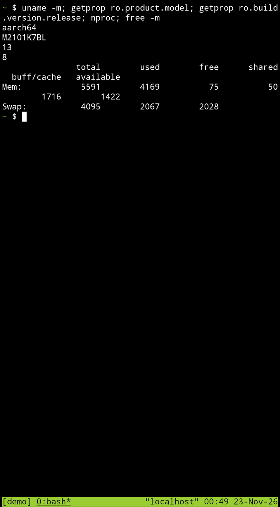

```bash
uname -m; getprop ro.product.model; getprop ro.build.version.release; nproc; free -m
```

`aarch64`, modelo M2101K7BL, Android 13, 8 núcleos y 5,5 GB de RAM visibles para el sistema. Referencia: [docs/inventario_dispositivo.md](inventario_dispositivo.md), bitácora Fase B.

### 02. Extensiones de la CPU

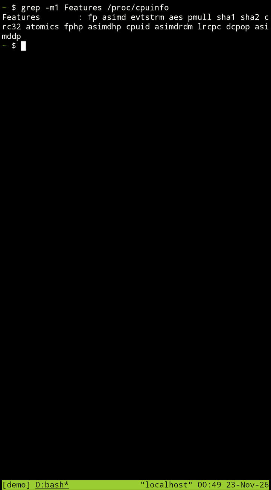

```bash
grep -m1 Features /proc/cpuinfo
```

Aparecen `asimd` (NEON), `asimddp` (producto escalar, dotprod) y `fphp`/`asimdhp` (FP16): justifican las banderas `armv8.2-a+dotprod+fp16`. Referencia: ADR-005.

## Etapa 1 — Preparación del teléfono y de Termux

### 03. Opciones de desarrollador

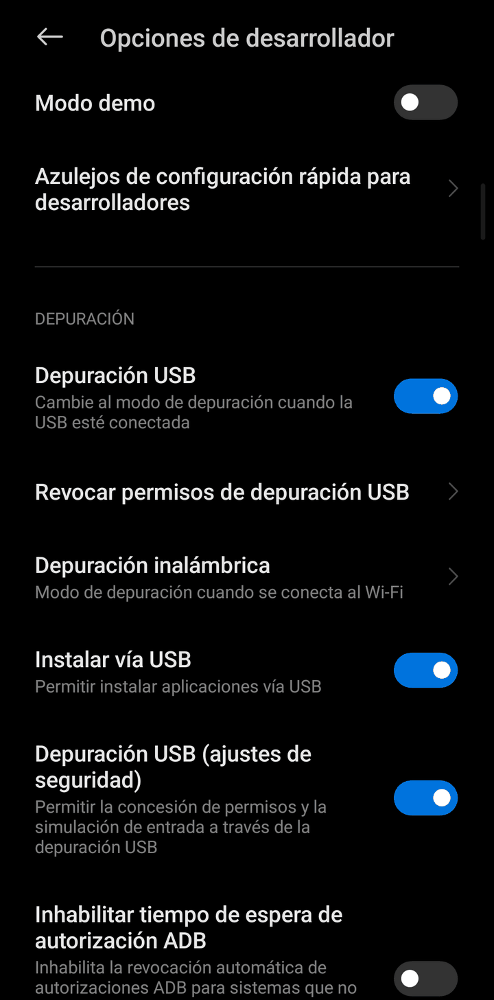

```bash
adb shell am start -a android.settings.APPLICATION_DEVELOPMENT_SETTINGS
```

Depuración USB y "Depuración USB (ajustes de seguridad)" activas; acceso a Depuración inalámbrica. Referencia: bitácora Fase B y [docs/problemas_conocidos.md](problemas_conocidos.md).

### 04. Permiso de micrófono de Termux:API

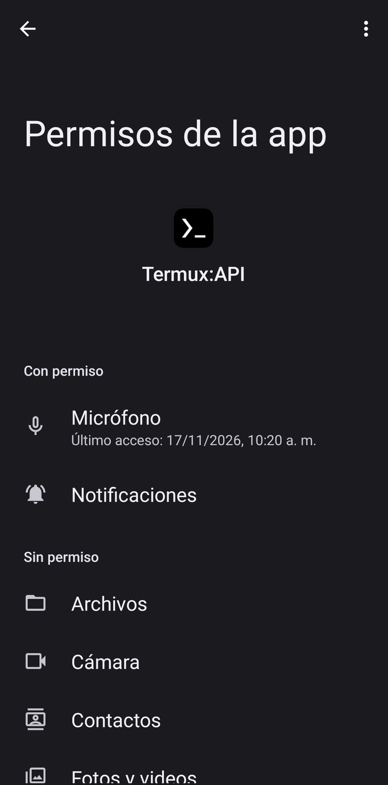

```bash
adb shell am start -a android.settings.APPLICATION_DETAILS_SETTINGS -d package:com.termux.api   # luego Permisos
```

Micrófono en "Con permiso" (`dumpsys package com.termux.api`: `RECORD_AUDIO: granted=true`). Referencia: bitácora Fase C.

### 05. Termux

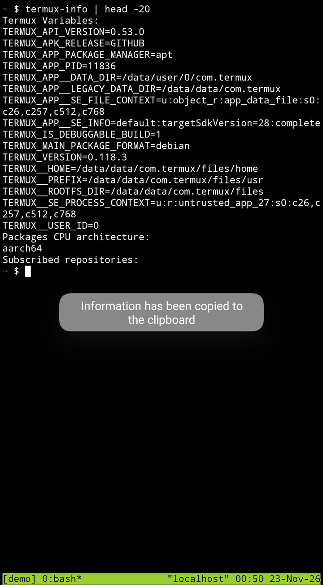

```bash
termux-info | head -20
```

Termux 0.118.3 (GitHub), Termux:API 0.53.0, gestor `apt`, arquitectura aarch64. Referencia: bitácora Fase C.

### 06. Paquetes instalados

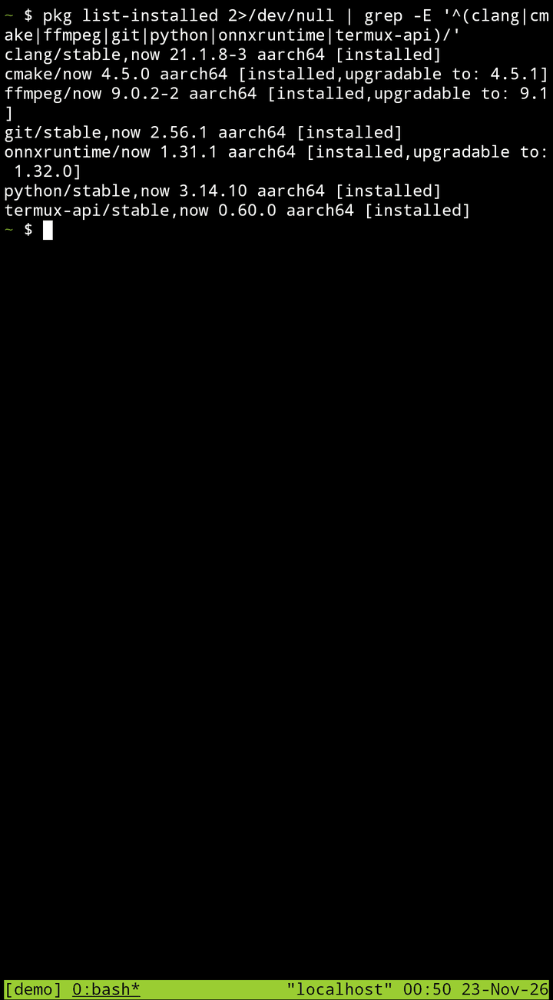

```bash
pkg list-installed 2>/dev/null | grep -E '^(clang|cmake|ffmpeg|git|python|onnxruntime|termux-api)/'
```

clang 21.1.8, cmake 4.5.0, ffmpeg 9.0.2, git 2.56.1, onnxruntime 1.31.1, python 3.14.10 y termux-api 0.60.0. Referencia: bitácora Fase E.

### 07. Compilador con dotprod y FP16

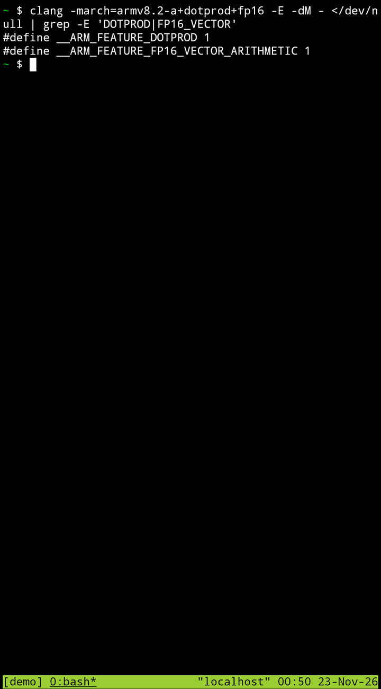

```bash
clang -march=armv8.2-a+dotprod+fp16 -E -dM - </dev/null | grep -E 'DOTPROD|FP16_VECTOR'
```

`__ARM_FEATURE_DOTPROD 1` y `__ARM_FEATURE_FP16_VECTOR_ARITHMETIC 1`: el compilador genera las instrucciones que usa llama.cpp. Referencia: ADR-005.

## Etapa 2 — Captura de audio

### 08. Grabación de 3 s con Termux:API

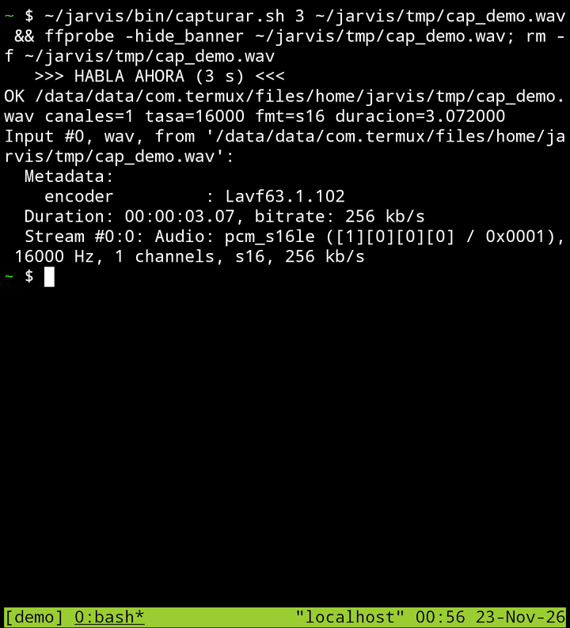

```bash
~/jarvis/bin/capturar.sh 3 ~/jarvis/tmp/cap_demo.wav && ffprobe -hide_banner ~/jarvis/tmp/cap_demo.wav; rm -f ~/jarvis/tmp/cap_demo.wav
```

Aviso "HABLA AHORA", WAV mono, 16 kHz, `s16`, 3,07 s. El archivo se borra al terminar (no se guarda voz). Referencia: bitácora Fase E, ADR-012.

## Instalación con `scripts/instalar_termux.sh`

### 09. Clonar el repositorio

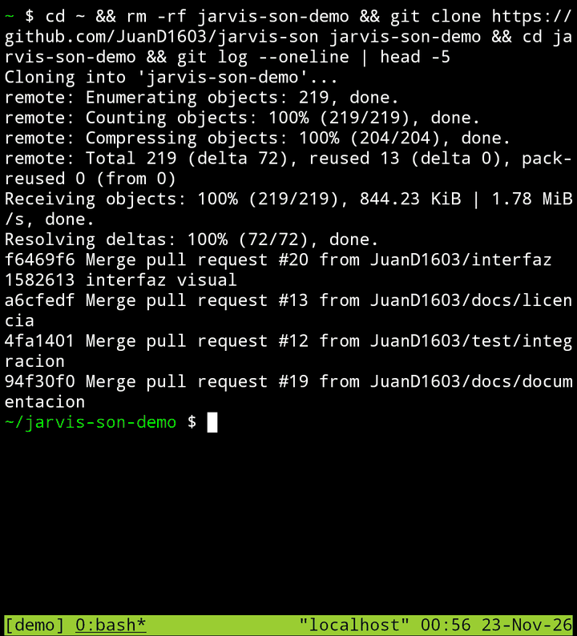

```bash
cd ~ && rm -rf jarvis-son-demo && git clone https://github.com/JuanD1603/jarvis-son jarvis-son-demo && cd jarvis-son-demo && git log --oneline | head -5
```

Clon de `main` en el commit `f6469f6`.

### 10-15. Compilar todo en un directorio limpio

```bash
JARVIS_HOME=~/jarvis_demo SIN_MODELOS=1 bash scripts/instalar_termux.sh 2>&1 | tee ~/jarvis_demo_install.log
```

Duración total: unos **27 minutos** (00:57-01:24): paquetes < 1 min, llama.cpp ~9 min, whisper.cpp ~3 min, sherpa-onnx ~15 min, orquestador < 1 min.

**10. Inicio y paquetes.** El comando y la etapa "Paquetes de Termux": `pkg install` actualizó cmake 4.5.0 -> 4.5.1, ffmpeg 9.0.2 -> 9.1 y onnxruntime 1.31.1 -> 1.32.0 (ver la incidencia de la captura 19b).

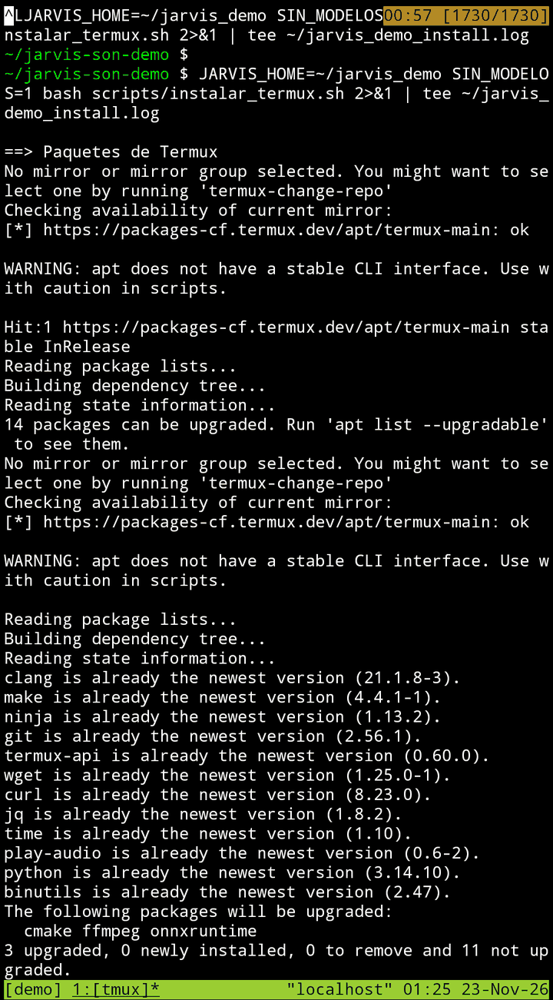

**11. CMake de llama.cpp.** Con `-march=armv8.2-a+dotprod+fp16`: `HAVE_DOTPROD - Success`, `HAVE_FP16_VECTOR_ARITHMETIC - Success`, `HAVE_FMA - Success` (SVE, I8MM y SME no existen en el Helio G95). Referencia: ADR-005.

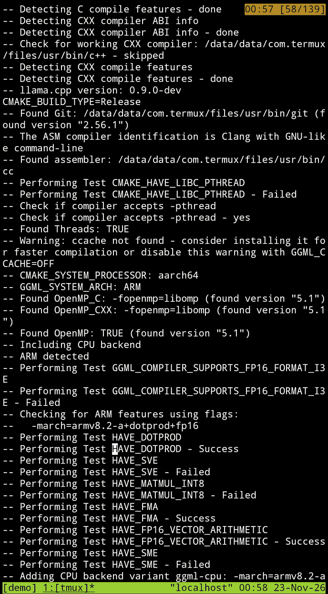

**12. Compilación de llama.cpp en curso** (commit fijado `92d6c8a`, 52/152 objetos).

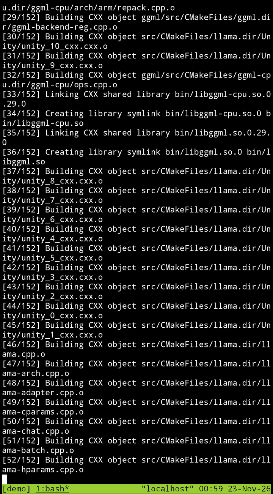

**13. Fin de llama.cpp e inicio de whisper.cpp.** `[152/152] Linking CXX executable bin/llama-bench` y comienzo de whisper.cpp (commit `d2c6f05`).

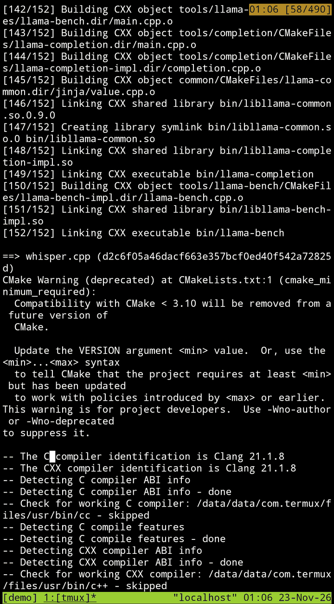

**14. Fin de whisper.cpp e inicio de sherpa-onnx.** `[44/44] Linking CXX executable bin/whisper-cli` (con una advertencia de terceros en `stb_vorbis.c`) y comienzo de sherpa-onnx v1.13.8 con el onnxruntime de Termux. Referencia: ADR-008.

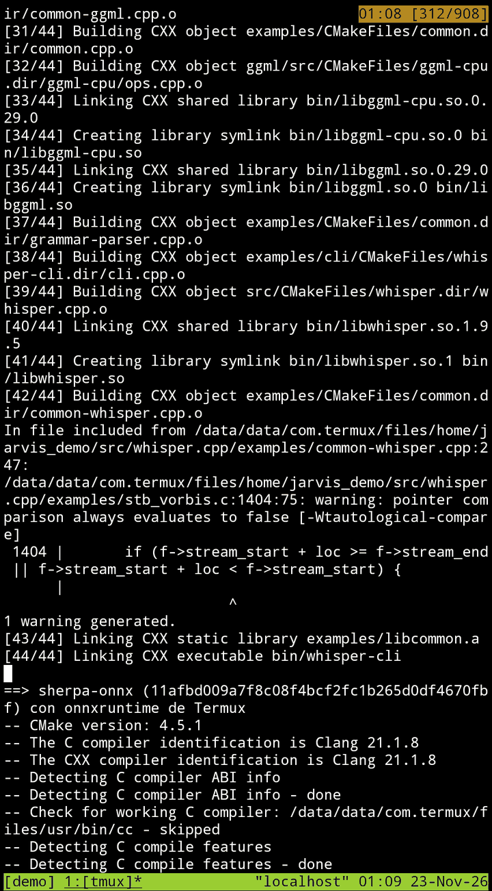

**15. sherpa-onnx, orquestador, pruebas y fin.** `[326/326] ... sherpa-onnx-offline-tts`, compilación del orquestador (9/9), `ctest`: **100% tests passed out of 2** (`pruebas_unitarias` y `turno_mock`) y el mensaje final "Listo". Referencia: bitácora Fase I.

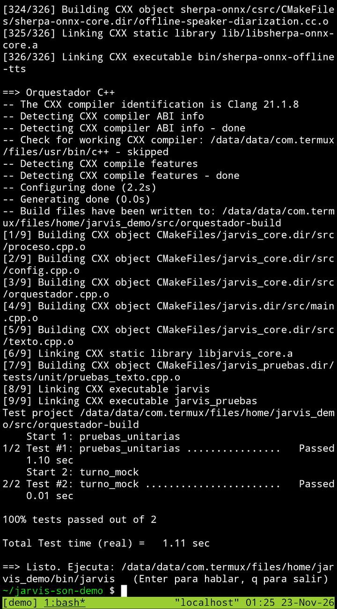

## Etapas 3 a 5 — Modelos

### 16. Modelos verificados con SHA-256

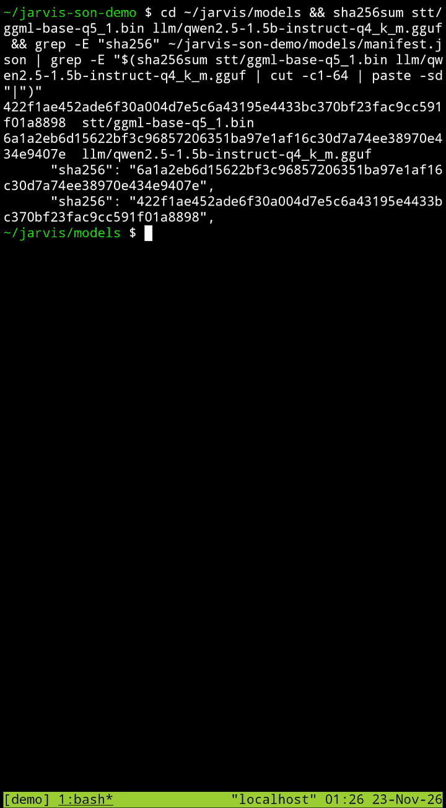

```bash
cd ~/jarvis/models && sha256sum stt/ggml-base-q5_1.bin llm/qwen2.5-1.5b-instruct-q4_k_m.gguf && grep -E "sha256" ~/jarvis-son-demo/models/manifest.json | grep -E "$(sha256sum stt/ggml-base-q5_1.bin llm/qwen2.5-1.5b-instruct-q4_k_m.gguf | cut -c1-64 | paste -sd"|")"
```

Los hashes de whisper base q5_1 (`422f1ae4...`) y Qwen2.5-1.5B Q4_K_M (`6a1a2eb6...`) aparecen en [models/manifest.json](../models/manifest.json): el segundo `grep` solo imprime las líneas del manifiesto que coinciden.

## Etapa 4 — Rendimiento del SLM

### 17. `llama-bench` con 2 hilos

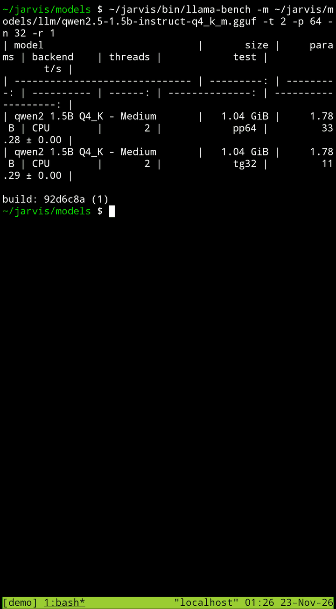

```bash
~/jarvis/bin/llama-bench -m ~/jarvis/models/llm/qwen2.5-1.5b-instruct-q4_k_m.gguf -t 2 -p 64 -n 32 -r 1
```

Qwen2.5-1.5B Q4_K_M (1,04 GiB): 33,28 tok/s al procesar el prompt (pp64) y 11,29 tok/s al generar (tg32), una sola repetición. Referencia: ADR-006, [docs/metricas/slm.md](metricas/slm.md).

## Etapa 3 — STT

### 18. Transcripción con whisper.cpp

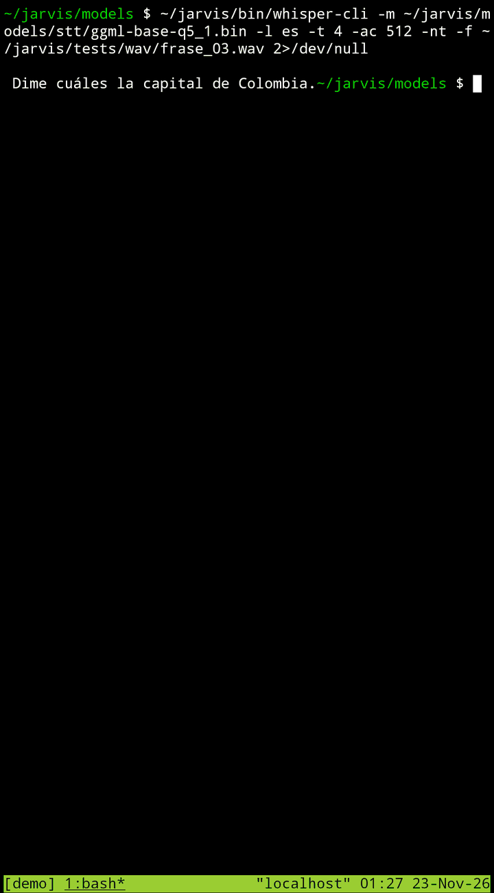

```bash
~/jarvis/bin/whisper-cli -m ~/jarvis/models/stt/ggml-base-q5_1.bin -l es -t 4 -ac 512 -nt -f ~/jarvis/tests/wav/frase_03.wav 2>/dev/null
```

Resultado: "Dime cuáles la capital de Colombia." (el error "cuáles" por "cuál es" es del modelo). Referencia: ADR-009, [docs/metricas/stt.md](metricas/stt.md).

## Etapa 6 — Orquestador

### 19. Turno completo voz a voz

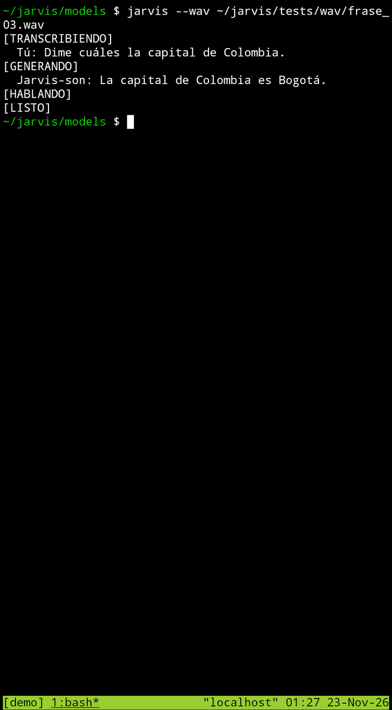

```bash
jarvis --wav ~/jarvis/tests/wav/frase_03.wav
```

Estados `[TRANSCRIBIENDO]`, `[GENERANDO]`, `[HABLANDO]` y `[LISTO]`, con "Tú:" y "Jarvis-son:" (turno 53, código 0). Referencia: bitácora Fase I.

### 19b. Incidencia: TTS roto tras actualizar onnxruntime

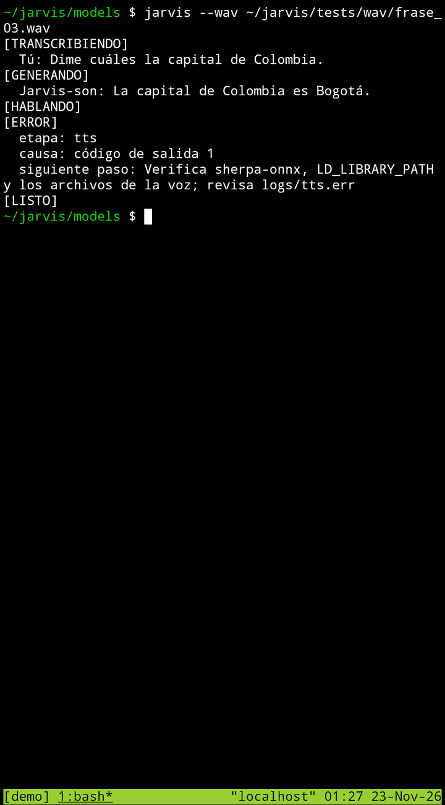

El primer intento (turno 52) terminó en `[ERROR] etapa: tts`. `logs/tts.err`: `cannot locate symbol "OrtGetApiBase"`. Causa: el instalador actualizó onnxruntime a 1.32.0, que exporta `OrtGetApiBase@@VERS_1.32.0`; el `sherpa-onnx-offline-tts` de `~/jarvis` se compiló el 2026-11-12 contra 1.31.1 y busca la versión de símbolo anterior. Solución aplicada: volver a instalar el paquete 1.31.1 que quedó en la caché de apt (`dpkg -i .../onnxruntime_1.31.1_aarch64.deb`); después el turno 53 terminó con código 0 (captura 19). La compilación de demostración no tuvo el problema porque se enlazó contra 1.32.0. Referencia: [docs/problemas_conocidos.md](problemas_conocidos.md).

## Etapa 7 — Integración y evaluación

### 20. Turno en modo avión

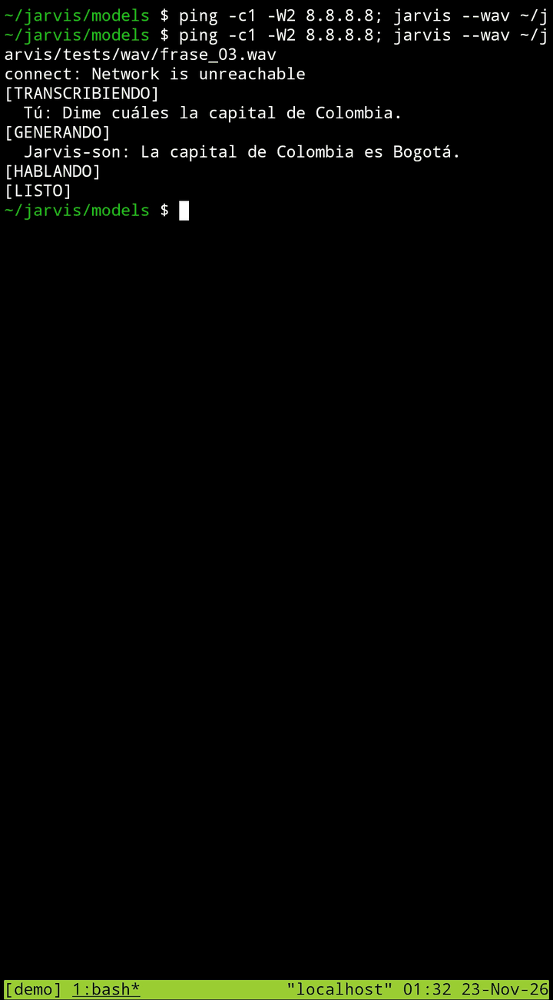

```bash
ping -c1 -W2 8.8.8.8; jarvis --wav ~/jarvis/tests/wav/frase_03.wav
```

Con el modo avión activado (el icono del avión quedó en la barra de estado, que se recortó por privacidad): `connect: Network is unreachable` y aun así el turno termina en `[LISTO]` (turno 54, código 0, 16,9 s). Captura tomada por la persona con Encendido + Bajar volumen. Referencia: bitácora Fase J.

### 21. Métricas p50/p95

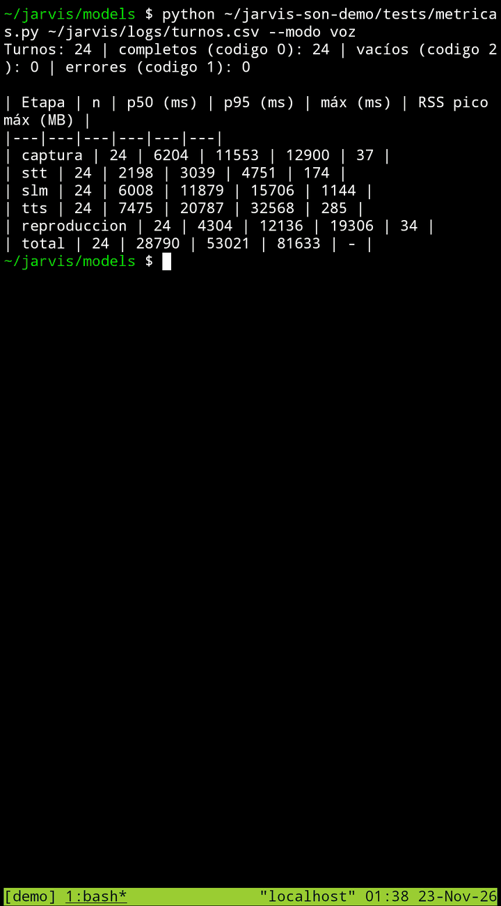

```bash
python ~/jarvis-son-demo/tests/metricas.py ~/jarvis/logs/turnos.csv --modo voz
```

24 turnos de voz, todos con código 0. p50 total 28.790 ms, p95 53.021 ms; RSS máximo del SLM 1.144 MB. Referencia: [docs/metricas/resultados_v1.md](metricas/resultados_v1.md).

## Interfaz web

### 22. Interfaz en LISTO

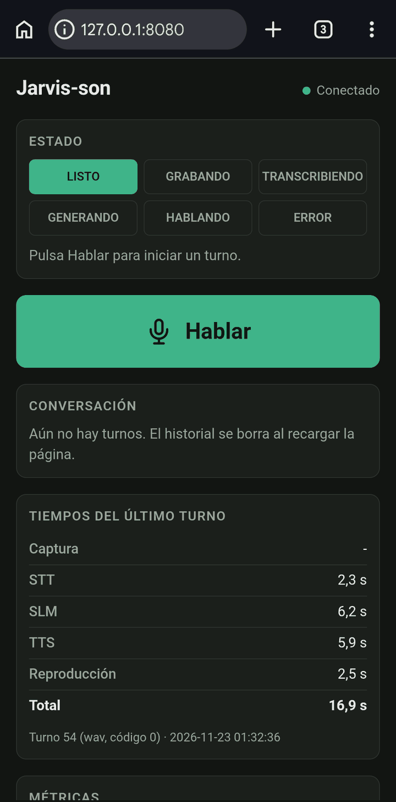

```bash
jarvis-web
```

El servidor escucha solo en `127.0.0.1:8080` y abre el navegador del teléfono; estado LISTO y tiempos del último turno (turno 54).

### 23. Interfaz tras un turno con voz

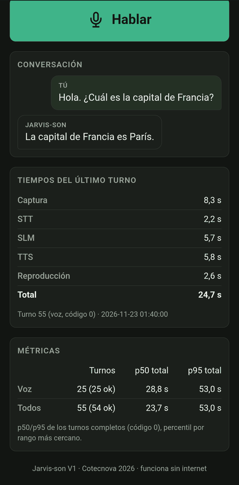

La persona pulsó **Hablar** y preguntó "Hola. ¿Cuál es la capital de Francia?"; respuesta "La capital de Francia es París." (turno 55, voz, código 0, 24,7 s en total). Debajo, las métricas acumuladas.

## Paso del plan -> evidencia

| Etapa del plan | Capturas | Bitácora / ADR |
|---|---|---|
| 0 · Inventario | 01, 02 | Fases A-B; ADR-005 |
| 1 · Teléfono, Termux y compilador | 03, 04, 05, 06, 07 | Fases B-E; ADR-005 |
| 2 · Captura de audio | 08 | Fase E; ADR-012 |
| Instalación reproducible | 09, 10, 11, 12, 13, 14, 15 | Fases F-I y K; ADR-005, ADR-008 |
| 3 · STT | 16, 18 | Fase G; ADR-009 |
| 4 · SLM | 16, 17 | Fase F; ADR-006, ADR-007 |
| 5 · TTS | 14, 15, 19, 19b | Fase H; ADR-008, ADR-010 |
| 6 · Orquestador | 15, 19 | Fase I; ADR-011 |
| 7 · Integración, modo avión y métricas | 20, 21, 22, 23 | Fase J |

Capturas tomadas en esta sesión: las 23 de la lista del plan, más la 19b (incidencia). Ninguna quedó sin tomar.
